<h1 align="center">👋 Hi, I'm Joe!</h1>

  

  Welcome to my <b>digital workshop / circus / dumpster fire</b>. 
  (It depends on the day. Today's forecast is above.)

  
  
  

## 🎯 Current Quest Log

| Quest | Status | Field notes |
|:--|:--|:--|
| Drink an alarming amount of Dr Pepper | ✅ Complete | The only quest I finish every single day. |
| Figure out why my PyTorch models think a cat is a hotdog | 🔄 In progress | Current theory: the cat is, in fact, a hotdog. |
| Find a second real-world use for Monkey C | 🔍 Searching | Use #1 was a watch face. Leads on #2 welcome. |
| Touch grass 🌱 | ⏳ Blocked | Waiting on the outdoors to ship dark mode. |

## 🎁 Loot Drops

  Proof that some quests actually get finished:

  
  &nbsp;
  

---

  <b>Thanks for stopping by!</b> 
  No cats or hotdogs were correctly identified in the making of this profile.

